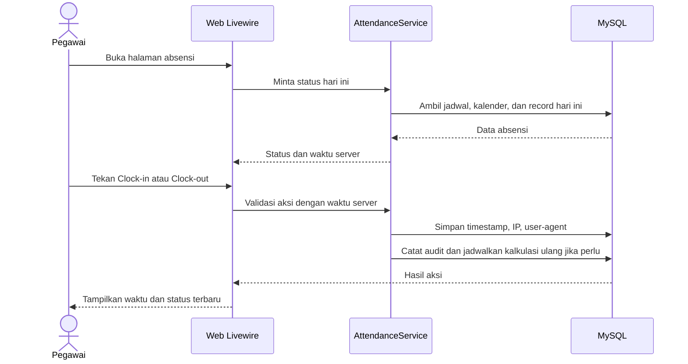
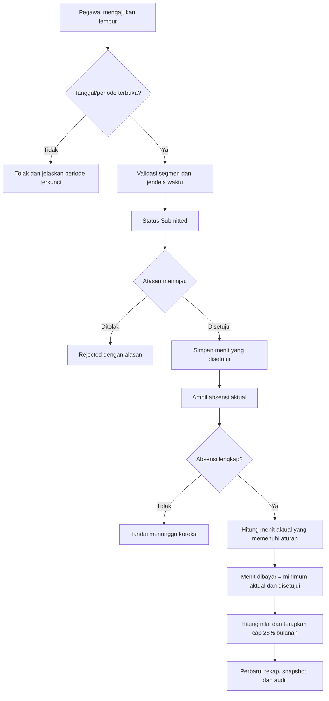
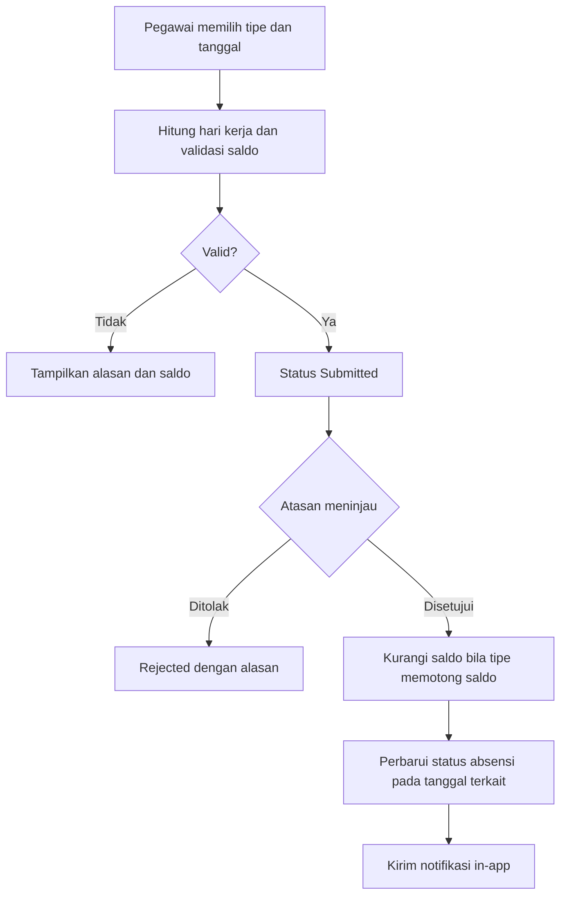
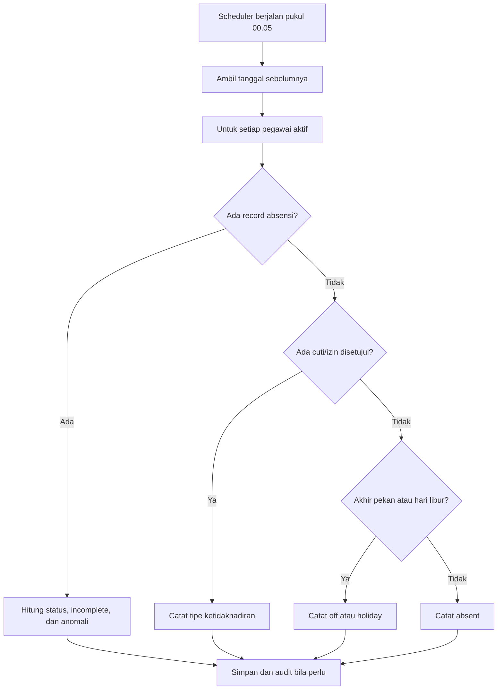
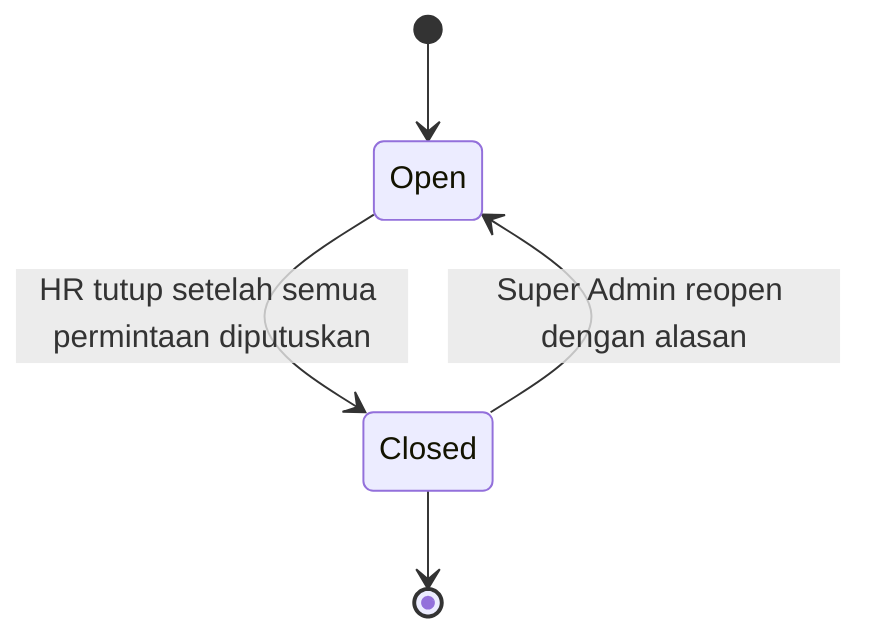
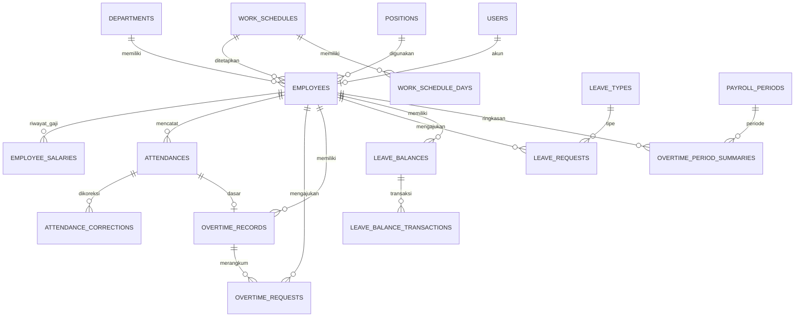
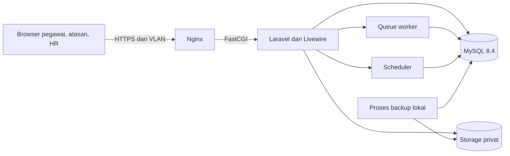
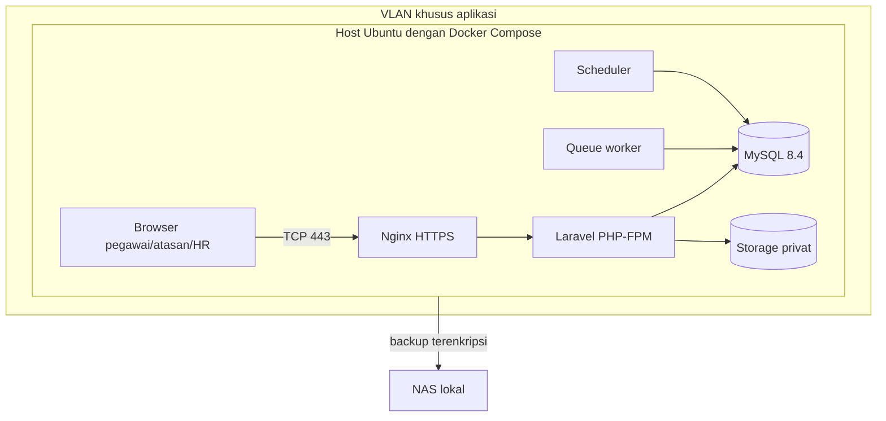

# PRD & Spesifikasi Teknis — Aplikasi Administrasi Pegawai

## Absensi, Cuti, dan Perhitungan Lembur

> **Status:** Draft v0.1 — perlu validasi HR/Finance/IT  
> **Tanggal:** 26 Oktober 2026  
> **Pemilik produk:** HR/Administrasi  
> **Target skala:** kurang dari 50 pegawai, satu lokasi  
> **Bahasa antarmuka:** Bahasa Indonesia  
> **Deployment:** server lokal melalui Docker Compose, akses hanya dari VLAN Wi-Fi khusus

Dokumen ini merangkum kebutuhan produk dan rancangan teknis awal berdasarkan keputusan yang sudah diberikan. Hal yang belum dipastikan ditandai **PERLU KONFIRMASI**; asumsi tersebut tidak boleh dianggap sebagai kebijakan final sebelum disetujui HR/Finance.

## Daftar Isi

1. [Ringkasan Eksekutif](#1-ringkasan-eksekutif)
2. [Latar Belakang dan Tujuan](#2-latar-belakang-dan-tujuan)
3. [Ruang Lingkup](#3-ruang-lingkup)
4. [Aktor dan Hak Akses](#4-aktor-dan-hak-akses)
5. [Kebutuhan Fungsional](#5-kebutuhan-fungsional)
6. [Aturan Bisnis](#6-aturan-bisnis)
7. [Alur Utama](#7-alur-utama)
8. [Rancangan Model Data](#8-rancangan-model-data)
9. [Arsitektur dan Tech Stack](#9-arsitektur-dan-tech-stack)
10. [Keamanan dan Kepatuhan](#10-keamanan-dan-kepatuhan)
11. [Deployment dan Operasional](#11-deployment-dan-operasional)
12. [Strategi Pengujian](#12-strategi-pengujian)
13. [Roadmap dan Estimasi](#13-roadmap-dan-estimasi)
14. [Risiko dan Mitigasi](#14-risiko-dan-mitigasi)
15. [Asumsi dan Pertanyaan Terbuka](#15-asumsi-dan-pertanyaan-terbuka)
16. [Lampiran](#16-lampiran)

---

## 1. Ringkasan Eksekutif

Aplikasi ini adalah aplikasi web internal untuk mengelola data dasar pegawai, mencatat absensi masuk/pulang, menangani pengajuan cuti/izin, menyetujui lembur, dan menghasilkan rekap absensi serta nilai lembur. Pegawai menggunakan browser melalui VLAN yang disediakan. Waktu dicatat oleh server, bukan oleh perangkat pegawai.

| Area | Keputusan awal |
|---|---|
| Metode absensi | Web self-service dengan akun lokal username/NIP dan password |
| Jadwal kerja | Senin–Kamis 09.00–17.30; Jumat 09.00–18.00; Sabtu/Minggu libur |
| Lembur hari kerja | USD 6 per jam; lembur pagi dan sore mengikuti jendela waktu pada Bagian 6 |
| Lembur akhir pekan/libur | USD 9 per jam untuk Sabtu/Minggu dan libur nasional Indonesia/Malaysia |
| Batas bulanan | Total lembur bulanan dibatasi 28% dari gaji pokok |
| Persetujuan | Pegawai mengajukan, atasan menyetujui; HR dapat melakukan koreksi/override dengan alasan dan audit |
| Cuti tahunan | 12 hari kerja per tahun, carry-over maksimal 6 hari selama satu tahun, saldo maksimal 18 hari; pegawai baru tidak dapat mengambil cuti tahunan pada tahun pertama |
| Antarmuka | Laravel dengan Blade/Livewire, mobile-friendly, Bahasa Indonesia |
| Deployment | Docker Compose, Nginx, PHP-FPM, MySQL, server lokal; port aplikasi hanya tersedia pada IP VLAN |

### Keputusan versi per 26 Oktober 2026

- **PHP:** minimum operasional yang disarankan adalah PHP **8.5.12**; PHP **8.4.27** menjadi fallback jika dependensi yang disetujui belum kompatibel dengan 8.5. PHP 8.2.35 memperbaiki RCE yang diumumkan pada Oktober 2026, tetapi Laravel 13 memerlukan PHP minimal 8.3 dan dukungan keamanan PHP 8.2 berakhir 31 Desember 2026.
- **Laravel:** Laravel **13.38.0 atau patch 13.x yang lebih baru** pada saat build/deploy.
- **UI:** Livewire **4.4.8 atau patch 4.x yang lebih baru**, dengan asset frontend dibundel dan disajikan dari server lokal.
- **Database:** MySQL 8.4 LTS.

Versi di atas adalah baseline yang diperiksa pada tanggal dokumen. Sebelum deploy, periksa kembali patch keamanan terbaru dan pin versi image/dependensi yang benar-benar dipakai.

## 2. Latar Belakang dan Tujuan

### 2.1 Latar belakang

Pencatatan absensi dan lembur secara manual atau melalui beberapa spreadsheet menyulitkan HR untuk menjaga konsistensi data, menghubungkan lembur aktual dengan persetujuan atasan, menghitung batas bulanan, dan menelusuri perubahan setelah rekap dikirim ke payroll. Aplikasi menyediakan satu sumber data dengan riwayat perubahan yang dapat diaudit.

### 2.2 Tujuan

1. Pegawai dapat mencatat waktu masuk dan pulang dari browser pada jaringan yang diizinkan.
2. HR dan atasan dapat melihat status absensi, mengelola pengajuan, serta meninjau perubahan data.
3. Perhitungan lembur mengikuti aturan internal yang dikonfigurasi, termasuk batas persetujuan dan cap 28% bulanan.
4. Saldo cuti tahunan, carry-over, persetujuan, dan pemakaian hari kerja tercatat dengan jelas.
5. Rekap dapat diekspor untuk pemeriksaan HR dan proses payroll eksternal.
6. Aplikasi tetap dapat dijalankan pada jaringan lokal tanpa CDN atau layanan cloud wajib.
7. Data pegawai dan gaji hanya dapat dilihat oleh peran yang berwenang.

### 2.3 Ukuran keberhasilan

| ID | Ukuran | Target awal |
|---|---|---|
| S-01 | Jejak persetujuan lembur | Semua lembur yang dibayar memiliki catatan permintaan, persetujuan, dan perhitungan |
| S-02 | Akurasi perhitungan | Semua contoh perhitungan pada Bagian 16 lulus uji otomatis dan UAT |
| S-03 | Ketertelusuran | Semua koreksi absensi, perubahan gaji, override, dan penutupan periode memiliki audit log |
| S-04 | Kinerja | Dashboard utama <2 detik dan rekap bulanan <5 detik pada skala sampai 50 pegawai dan 5 tahun data |
| S-05 | Pemulihan | Backup harian berhasil; uji restore mencapai RPO 24 jam dan target RTO 4 jam |
| S-06 | Batas jaringan | Aplikasi tidak dapat diakses dari luar VLAN yang diizinkan dan database tidak dipublikasikan ke jaringan klien |

## 3. Ruang Lingkup

### 3.1 Termasuk dalam MVP

| Modul | Cakupan |
|---|---|
| Akun dan akses | Login lokal, peran, perubahan password, reset oleh admin, pembatasan akses berbasis peran |
| Data pegawai | NIP, nama, departemen, jabatan, atasan, status kerja, tanggal masuk, jadwal, dan riwayat gaji yang diperlukan untuk cap lembur |
| Jadwal dan kalender | Jadwal tetap, akhir pekan, kalender libur Indonesia dan Malaysia yang dikelola admin |
| Absensi | Clock-in/clock-out, status harian, keterlambatan, pulang cepat, penandaan anomali, koreksi admin |
| Cuti dan izin | Pengajuan dan persetujuan cuti tahunan, sakit, izin, dan dinas luar; saldo cuti tahunan |
| Lembur | Pengajuan, persetujuan, kalkulasi jam aktual, tarif hari kerja/libur, cap bulanan, koreksi dan audit |
| Rekap | Laporan absensi, lembur, cuti, dan audit; ekspor Excel/PDF |
| Operasional | Penutupan periode bulanan, notifikasi dalam aplikasi, backup, dan deployment Docker Compose |

### 3.2 Tidak termasuk dalam MVP

| Di luar cakupan | Catatan |
|---|---|
| Payroll penuh | Tidak menghitung gaji bersih, pajak, BPJS, potongan, atau transfer gaji. Rekap lembur menjadi masukan payroll eksternal. |
| Integrasi mesin fingerprint/face recognition | Sumber absensi MVP adalah web self-service. |
| Aplikasi native Android/iOS | Aplikasi web responsif cukup untuk MVP. |
| QR dinamis, selfie, atau biometrik | Dapat dipertimbangkan jika hasil pilot menunjukkan risiko titip absen. |
| Akses internet publik, email, WhatsApp, atau API publik | Notifikasi MVP hanya di dalam aplikasi. |
| Multi-perusahaan atau multi-lokasi | Target hanya satu lokasi dan satu zona waktu. |
| Roster shift bergilir | Jadwal tetap sesuai informasi saat ini. |
| Manajemen kontrak/dokumen HR lengkap | Dokumen pendukung cuti sakit dapat diunggah; bukan repositori dokumen pegawai. |
| Cuti setengah hari | MVP menggunakan satuan hari kerja penuh. |

## 4. Aktor dan Hak Akses

### 4.1 Peran

| Peran | Tanggung jawab |
|---|---|
| **Super Admin** | Konfigurasi sistem dan keamanan, pengelolaan akun admin, akses audit penuh, serta membuka kembali periode yang sudah ditutup. |
| **HR Admin** | Master pegawai dan gaji, koreksi absensi, pengelolaan cuti/lembur, rekap, penutupan periode, dan override dengan alasan. Tidak mengelola akun Super Admin. |
| **Atasan** | Melihat tim yang menjadi tanggung jawabnya, menyetujui/menolak lembur dan cuti/izin, serta melihat jam lembur tim tanpa nominal gaji/lembur. |
| **Pegawai** | Clock-in/out, melihat data sendiri, mengajukan lembur/cuti/izin, dan melihat saldo serta rekap miliknya sendiri. |

Satu akun memiliki satu peran utama. Akun Atasan tetap terhubung ke data pegawai agar dapat menggunakan absensi self-service. Penentuan tim menggunakan relasi atasan langsung pada data pegawai. Jika atasan tidak tersedia atau menjadi pemohon, HR menangani persetujuan untuk mencegah persetujuan mandiri.

### 4.2 Matriks akses awal

| Aksi | Super Admin | HR Admin | Atasan | Pegawai |
|---|---:|---:|---:|---:|
| Clock-in/out dan lihat absensi sendiri | Ya | Ya | Ya | Ya |
| Lihat absensi bawahan | Ya | Ya | Ya, tim sendiri | Tidak |
| Mengubah waktu absensi | Ya | Ya, dengan alasan | Tidak | Tidak |
| Mengajukan lembur/cuti | Ya, jika terhubung ke pegawai | Ya, jika terhubung ke pegawai | Ya, untuk diri sendiri | Ya |
| Menyetujui lembur/cuti bawahan | Ya | Ya, override dengan alasan | Ya, tim sendiri | Tidak |
| Melihat nominal lembur/gaji pegawai lain | Ya | Ya | Tidak | Tidak |
| Melihat nominal lembur sendiri | Ya | Ya | Ya | Ya |
| Mengelola data pegawai/departemen/jabatan | Ya | Ya | Tidak | Tidak |
| Mengelola gaji dan kebijakan lembur/cuti | Ya | Ya | Tidak | Tidak |
| Melihat/mengunduh laporan | Semua | Semua | Tim sendiri, tanpa nominal gaji | Data sendiri |
| Menutup periode | Ya | Ya | Tidak | Tidak |
| Membuka kembali periode tertutup | Ya, dengan alasan | Tidak | Tidak | Tidak |
| Mengelola akun Super Admin | Ya | Tidak | Tidak | Tidak |
| Melihat audit log | Ya | Ya | Tidak | Tidak |

Semua akses di backend dan aksi Livewire harus menggunakan authorization policy. Menyembunyikan tombol di UI saja bukan kontrol akses yang memadai.

## 5. Kebutuhan Fungsional

Prioritas: **Must** = wajib untuk MVP, **Should** = penting bila kapasitas memungkinkan, **Could** = dapat masuk iterasi berikutnya.

### 5.1 Akun dan autentikasi

| ID | Kebutuhan | Prioritas | Kriteria penerimaan |
|---|---|---|---|
| FR-01 | Login menggunakan username/NIP dan password lokal; tidak bergantung pada email atau internet. | Must | Akun aktif dapat masuk; akun nonaktif ditolak; pesan gagal tidak membocorkan apakah username terdaftar. |
| FR-02 | Password sementara harus diganti pada login pertama; pengguna dapat mengganti password sendiri. | Must | Akun belum dapat menggunakan modul setelah login pertama sampai password diganti. |
| FR-03 | HR/Super Admin dapat menonaktifkan akun atau memulai reset password. | Must | Password baru sementara hanya ditampilkan sekali dan perubahan tercatat. |
| FR-04 | Batasi percobaan login dan catat hasil login. | Must | Percobaan berulang dibatasi; login berhasil/gagal memiliki waktu dan sumber IP pada log keamanan. |
| FR-05 | Dukung TOTP 2FA untuk akun Super Admin dan HR. | Should | Dapat diwajibkan melalui konfigurasi sebelum produksi; recovery codes tersimpan secara aman. |
| FR-06 | Akun pegawai terkait tepat dengan data pegawai; akun admin sistem dapat tidak terkait pegawai. | Must | Username/NIP unik dan akun tidak dapat melihat data pegawai lain tanpa hak yang sesuai. |

### 5.2 Master pegawai dan organisasi

| ID | Kebutuhan | Prioritas | Kriteria penerimaan |
|---|---|---|---|
| FR-07 | HR mengelola departemen, jabatan, atasan, status kerja, tanggal masuk/keluar, dan jadwal pegawai. | Must | Perubahan master tervalidasi dan tercatat di audit log. |
| FR-08 | Data pegawai mempunyai NIP unik dan status aktif/nonaktif. | Must | Pegawai nonaktif tidak dapat clock-in; riwayat lama tetap dapat dilaporkan. |
| FR-09 | Riwayat gaji pokok disimpan berdasarkan tanggal berlaku. | Must | Perubahan gaji tidak menimpa riwayat sebelumnya dan hanya HR/Super Admin yang dapat melihat/mengubahnya. |
| FR-10 | Sediakan impor CSV untuk master pegawai dan kalender libur. | Should | Validasi per baris, laporan baris gagal, dan tidak menimpa data tanpa konfirmasi. |

### 5.3 Jadwal dan kalender

| ID | Kebutuhan | Prioritas | Kriteria penerimaan |
|---|---|---|---|
| FR-11 | Jadwal default mendukung Senin–Kamis 09.00–17.30 dan Jumat 09.00–18.00. | Must | Jam kerja ditampilkan sesuai jadwal pegawai dan dapat diubah oleh admin melalui pengaturan. |
| FR-12 | Admin mengelola hari libur Indonesia dan Malaysia, termasuk tanggal pengganti/cuti bersama yang disepakati perusahaan. | Must | Kalender dapat ditambah, diubah, dinonaktifkan, dan diimpor; setiap perubahan diaudit. |
| FR-13 | Sistem menentukan hari kerja, akhir pekan, dan hari libur secara konsisten. | Must | Sabtu/Minggu diperlakukan sebagai akhir pekan; tanggal yang ada pada kalender ID atau MY memakai aturan libur. |

### 5.4 Absensi

| ID | Kebutuhan | Prioritas | Kriteria penerimaan |
|---|---|---|---|
| FR-14 | Pegawai clock-in dan clock-out melalui halaman web yang responsif. | Must | Tombol/status jelas; waktu berasal dari server; timestamp perangkat tidak dipercaya. |
| FR-15 | Cegah clock-in ganda dan clock-out tanpa clock-in. | Must | Constraint database dan validasi aplikasi mencegah duplikasi pada pegawai/tanggal yang sama. |
| FR-16 | Simpan IP dan user-agent untuk clock-in/out sebagai data pemeriksaan. | Must | Nilai tersedia pada detail absensi dan hanya terlihat oleh peran berwenang. |
| FR-17 | Tampilkan keterlambatan, pulang cepat, hari libur, akhir pekan, dan absensi belum lengkap. | Must | Ringkasan harian dan bulanan konsisten dengan jadwal dan kalender. |
| FR-18 | HR dapat mengoreksi jam/status absensi dengan alasan wajib. | Must | Nilai lama/baru, pelaku, waktu, alasan, dan IP dicatat; kalkulasi lembur terkait dijalankan ulang. |
| FR-19 | Tandai clock-in tanpa clock-out sebagai belum lengkap; jangan membayar lembur sampai diperbaiki. | Must | Status tampil sebagai perlu koreksi dan tidak masuk nilai lembur final. |
| FR-20 | Tandai pola tidak wajar untuk ditinjau HR, bukan otomatis menghapus data. | Should | Contoh: jam di luar pola, clock-out lintas tengah malam, atau lembur awal yang sangat panjang. |

### 5.5 Cuti dan izin

| ID | Kebutuhan | Prioritas | Kriteria penerimaan |
|---|---|---|---|
| FR-21 | Pegawai mengajukan cuti tahunan, sakit, izin, atau dinas luar dengan tanggal dan alasan. | Must | Permintaan mempunyai status dan riwayat perubahan; tipe tertentu dapat mewajibkan lampiran. |
| FR-22 | Sistem menghitung hari cuti tahunan sebagai hari kerja, tidak termasuk akhir pekan/libur. | Must | Hari libur ID/MY dan Sabtu/Minggu tidak mengurangi saldo. |
| FR-23 | Saldo mengikuti jatah 12 hari, carry-over maks 6 hari selama satu tahun, saldo maks 18 hari, serta larangan cuti tahunan pada tahun pertama. | Must | Saldo dan transaksi perubahan dapat ditelusuri; permintaan di atas saldo ditolak. |
| FR-24 | Atasan menyetujui/menolak pengajuan; HR dapat override dengan alasan. | Must | Pemohon tidak dapat menyetujui permintaannya sendiri; alasan penolakan/override tersimpan. |
| FR-25 | Permintaan yang disetujui tercermin pada rekap absensi. | Must | Status cuti/sakit/izin/dinas luar tidak dihitung sebagai mangkir. |

### 5.6 Lembur

| ID | Kebutuhan | Prioritas | Kriteria penerimaan |
|---|---|---|---|
| FR-26 | Pegawai mengajukan lembur per tanggal dan segmen pagi/sore/libur dengan alasan. | Must | Sistem menunjukkan jendela waktu dan estimasi menit yang dapat diajukan. |
| FR-27 | Atasan menyetujui/menolak jumlah jam; HR dapat melakukan override dengan alasan dan audit. | Must | Permintaan yang ditolak tidak menjadi jam yang disetujui; pemohon tidak menyetujui permintaannya sendiri. |
| FR-28 | Hitung waktu aktual dari clock-in/out menggunakan aturan internal pada Bagian 6. | Must | Kalkulator murni memiliki unit test untuk setiap jendela dan kondisi batas. |
| FR-29 | Jam yang dapat dibayar adalah minimum dari menit aktual yang memenuhi aturan dan menit yang disetujui. | Must | Aktual 3 jam/disetujui 2 jam menghasilkan maksimal 2 jam; aktual 1 jam/disetujui 2 jam menghasilkan 1 jam. |
| FR-30 | Terapkan tarif USD 6/jam hari kerja dan USD 9/jam akhir pekan/libur serta cap bulanan 28% gaji pokok. | Must | Perhitungan menyimpan rincian tarif, gross, cap, paid, dan forfeited. |
| FR-31 | Simpan snapshot aturan/tarif pada hasil perhitungan. | Must | Perubahan tarif baru tidak mengubah periode lama secara diam-diam. |
| FR-32 | HR dapat melihat lembur menunggu persetujuan, aktual, disetujui, dibayar, dan yang terkena cap. | Must | Laporan memperlihatkan selisih aktual vs persetujuan serta alasan override. |

### 5.7 Dashboard, laporan, dan notifikasi

| ID | Kebutuhan | Prioritas | Kriteria penerimaan |
|---|---|---|---|
| FR-33 | Dashboard pegawai menampilkan status hari ini, riwayat sendiri, saldo cuti, dan ringkasan lembur sendiri. | Must | Pegawai tidak dapat mengakses data pegawai lain dengan mengubah URL/ID. |
| FR-34 | Dashboard atasan menampilkan status tim dan permintaan menunggu persetujuan. | Must | Cakupan data mengikuti relasi atasan langsung. |
| FR-35 | Dashboard HR menampilkan ringkasan hadir/terlambat/absen, anomali, persetujuan tertunda, dan status periode. | Must | Filter tanggal/departemen tersedia. |
| FR-36 | Sediakan rekap absensi harian/bulanan, lembur bulanan/detail, saldo cuti, dan audit. | Must | Filter dan angka pada laporan konsisten dengan data sumber. |
| FR-37 | Ekspor laporan ke Excel dan PDF. | Must | Hak akses diterapkan sebelum ekspor; setiap ekspor sensitif tercatat. |
| FR-38 | Notifikasi persetujuan dan status permintaan tersedia di dalam aplikasi. | Must | Pegawai/atasan menerima pemberitahuan in-app; tidak ada ketergantungan email/WhatsApp. |

### 5.8 Audit dan penutupan periode

| ID | Kebutuhan | Prioritas | Kriteria penerimaan |
|---|---|---|---|
| FR-39 | Catat login, perubahan master/gaji, koreksi, approval, override, ekspor, perubahan aturan, dan penutupan periode. | Must | Audit memuat pelaku, waktu, objek, nilai sebelum/sesudah jika relevan, alasan, dan IP. |
| FR-40 | HR dapat menutup periode bulanan setelah semua permintaan ditinjau. | Must | Penutupan menghitung ulang ringkasan dan mengunci perubahan periode. |
| FR-41 | Hanya Super Admin dapat membuka kembali periode dengan alasan. | Must | Reopen tercatat dan kalkulasi periode dijalankan ulang sebelum ditutup kembali. |

## 6. Aturan Bisnis

### 6.1 Jadwal, waktu, dan status absensi

1. Jadwal awal adalah Senin–Kamis pukul **09.00–17.30**, Jumat pukul **09.00–18.00**, dan Sabtu/Minggu libur.
2. **Asumsi awal:** istirahat 12.00–13.00. Jam istirahat memengaruhi laporan jam kerja efektif, bukan jendela lembur pagi/sore. HR perlu mengonfirmasi jadwal istirahat resmi.
3. Zona waktu default adalah `Asia/Jakarta`; dapat diubah menjadi `Asia/Kuala_Lumpur` jika lokasi operasional berada di Malaysia. Waktu aplikasi, server, dan database harus memakai satu zona waktu yang sama pada MVP.
4. Waktu clock-in/out ditentukan oleh server. Perangkat pegawai tidak dapat mengirim timestamp sebagai sumber kebenaran.
5. **Asumsi awal:** toleransi keterlambatan 0 menit. Menit keterlambatan tetap dihitung dari jam mulai; pengaturan toleransi hanya menentukan kapan status berubah menjadi terlambat.
6. Pegawai hanya memiliki satu record absensi per tanggal kerja. Skenario keluar-masuk berulang tidak termasuk MVP; koreksi dilakukan HR dengan catatan.
7. Status absensi dipisahkan dari jenis hari. Contoh: pegawai yang bekerja pada hari libur memiliki status `present` dan `day_type=holiday`.
8. Pegawai yang memiliki clock-in tanpa clock-out ditandai `incomplete`. Seluruh lembur pada tanggal tersebut ditahan dari perhitungan final sampai HR melengkapi/koreksi data.
9. Job harian memfinalisasi tanggal sebelumnya: hari kerja tanpa clock-in menjadi absent; hari libur/akhir pekan dan cuti yang disetujui mendapat status sesuai kalender/permintaan. Dashboard hari berjalan menghitung pegawai yang diharapkan hadir secara dinamis agar belum clock-in tidak langsung dianggap mangkir.
10. Perubahan kalender libur setelah rekap dibuat harus memicu kalkulasi ulang tanggal yang terdampak dan dicatat di audit.

### 6.2 Klasifikasi hari

| Jenis hari | Penentuan | Tarif lembur |
|---|---|---:|
| Hari kerja biasa | Senin–Jumat dan tidak ada pada kalender libur | USD 6/jam |
| Akhir pekan | Sabtu atau Minggu | USD 9/jam |
| Hari libur | Tanggal tercatat sebagai hari libur nasional Indonesia atau Malaysia | USD 9/jam |

Jika satu tanggal tercatat sebagai libur di dua kalender sekaligus, tarif tetap USD 9/jam, tidak digandakan. **Asumsi:** kedua kalender merupakan union; HR mengelola tanggal yang benar-benar diakui perusahaan, termasuk tanggal pengganti/cuti bersama. Sistem tidak mengambil kalender dari internet.

### 6.3 Formula lembur internal

#### Tarif dan cap

- Tarif hari kerja biasa: **USD 6,00 per jam**.
- Tarif Sabtu/Minggu dan hari libur nasional Indonesia/Malaysia: **USD 9,00 per jam**.
- Cap total nilai lembur per pegawai per bulan: **28% dari gaji pokok bulanan**. Berdasarkan konfirmasi, 28% adalah batas maksimum, bukan tunjangan tambahan.
- Semua nominal diasumsikan dalam **USD**. **PERLU KONFIRMASI:** gaji pokok juga harus dicatat dalam USD agar cap dapat dihitung tanpa kurs.

#### Jendela lembur hari kerja

| Segmen | Hari | Jendela yang dihitung | Aturan |
|---|---|---|---|
| Pagi | Senin–Jumat, hari biasa | 00.01 sampai 09.00 | Menit yang dihitung adalah irisan waktu hadir aktual dengan jendela ini; mulai paling awal 00.01. |
| Sore | Senin–Kamis, hari biasa | 18.00 sampai 23.59 | Jam kerja berakhir 17.30; grace 30 menit. |
| Sore | Jumat, hari biasa | 18.30 sampai 23.59 | Jam kerja berakhir 18.00; grace 30 menit. |

Lembur pagi dihitung dari waktu clock-in sampai 09.00, bukan otomatis dari 00.01. Contoh: clock-in 07.00 menghasilkan maksimal 120 menit lembur pagi jika disetujui. Lembur pagi tidak berlaku pada Sabtu/Minggu atau hari libur; hari tersebut memakai aturan libur.

#### Akhir pekan dan hari libur

Pada Sabtu/Minggu atau hari libur yang diakui, seluruh waktu hadir aktual dalam tanggal tersebut dihitung pada tarif USD 9/jam, tanpa grace 30 menit hari kerja. Waktu dibatasi pada 00.01–23.59 tanggal tersebut.

**Asumsi yang perlu disetujui:** untuk sesi lebih dari 6 jam, potong istirahat 60 menit; sesi 6 jam atau kurang tidak dipotong. HR dapat memilih aturan lain pada konfigurasi. Kebijakan istirahat ini memengaruhi jumlah jam yang dibayar.

#### Aktual, persetujuan, dan override

1. Menit aktual dihitung dari timestamp absensi yang sah, lalu dipotong sesuai jendela lembur pada hari tersebut.
2. Menit yang disetujui berasal dari permintaan lembur yang disetujui atasan. Rentang permintaan di luar jendela yang diizinkan tidak menghasilkan menit disetujui.
3. Menit yang dapat dibayar per tanggal adalah `min(menit aktual memenuhi aturan, menit disetujui)`.
4. Jika tidak ada persetujuan, lembur tidak masuk nilai pembayaran. Pengajuan setelah pekerjaan dilakukan diperbolehkan selama periode masih terbuka.
5. HR dapat mengubah clock-in/out dengan alasan wajib dan audit log. Override attendance mengubah waktu aktual, tetapi **tidak** otomatis menaikkan jam yang disetujui. Perubahan jumlah persetujuan harus dilakukan sebagai override approval tersendiri dengan alasan.
6. Permintaan yang tumpang tindih pada tanggal yang sama harus ditolak atau digabungkan agar menit disetujui tidak dihitung dua kali.

#### Cap bulanan

1. `cap_bulanan = gaji_pokok_bulanan × 28%`.
2. `gross = jumlah nilai lembur yang telah memenuhi persetujuan`.
3. `dibayar = min(gross, cap_bulanan)` dan `kelebihan = max(0, gross - cap_bulanan)`.
4. **Asumsi awal:** kelebihan cap tidak dibawa ke bulan berikutnya. Cap dialokasikan kronologis dari tanggal lembur paling awal; detail per tanggal disimpan agar rekap dapat menjelaskan bagian yang terkena cap.
5. **PERLU KONFIRMASI:** jika gaji berubah di tengah bulan, rancangan awal menggunakan gaji yang berlaku pada hari terakhir periode untuk menghitung cap bulan tersebut.
6. Setiap perubahan clock-in/out, approval, tarif, gaji, atau hari libur memicu kalkulasi ulang seluruh ringkasan bulan pegawai terkait. Snapshot tarif dan aturan yang dipakai disimpan pada hasil perhitungan.

#### Presisi dan batas

- **Asumsi awal:** pembulatan dilakukan per menit; nominal akhir dibulatkan ke dua desimal USD. USD 6/jam setara USD 0,10/menit dan USD 9/jam setara USD 0,15/menit.
- **PERLU KONFIRMASI:** minimum lembur dan pembulatan ke 15/30 menit jika kebijakan perusahaan mengharuskannya.
- Jam lembur hari biasa dibatasi sampai 23.59. Clock-out lintas tengah malam ditandai anomali; bagian setelah 23.59 tidak ditambahkan ke tanggal sebelumnya.
- Untuk pegawai yang tunduk pada PP 35/2021, aturan mencantumkan batas waktu lembur harian/mingguan dan perlakuan tersendiri untuk istirahat mingguan/hari libur. **PERLU TINJAUAN HR/legal:** jendela internal di atas dapat menghasilkan durasi harian yang jauh melampaui batas umum 4 jam/hari; aplikasi harus menandai pelanggaran ambang hukum yang disepakati. Ketentuan yang berlaku bagi pekerja Malaysia harus ditinjau terpisah.
- Sistem memberi peringatan pada ambang durasi tinggi. MVP tidak menghapus atau mengubah jam aktual otomatis; keputusan pembayaran/penanganan dilakukan oleh HR sesuai kebijakan yang disahkan.

### 6.4 Aturan cuti tahunan

1. Jatah cuti tahunan adalah **12 hari kerja per tahun**.
2. Pegawai baru tidak dapat mengajukan cuti tahunan pada tahun pertama. **Asumsi awal:** tahun pertama berarti 12 bulan sejak tanggal masuk; sakit dan izin non-cuti tetap dapat diajukan.
3. Carry-over dari tahun sebelumnya maksimal **6 hari**, berlaku selama satu tahun cuti berikutnya, lalu kedaluwarsa.
4. Saldo maksimal adalah **18 hari** (12 hari tahun berjalan + maksimal 6 hari carry-over).
5. **Asumsi awal:** tahun cuti dihitung berdasarkan anniversary tanggal masuk. **PERLU KONFIRMASI:** perusahaan mungkin menggunakan tahun kalender.
6. Hari yang dipotong adalah hari kerja sesuai jadwal; Sabtu/Minggu dan tanggal libur ID/MY tidak mengurangi saldo.
7. Cuti tahunan mengurangi saldo. **Asumsi awal:** sakit, izin, dan dinas luar tidak mengurangi saldo cuti tahunan; sakit memerlukan lampiran pendukung.
8. MVP hanya mendukung cuti satuan hari penuh. Permintaan harus memiliki saldo mencukupi, tidak tumpang tindih, dan mendapat persetujuan atasan.
9. HR dapat menambah/mengurangi saldo dengan alasan; perubahan menjadi transaksi saldo yang tidak dihapus dan tercatat di audit.

### 6.5 Status permintaan dan penutupan periode

| Objek | Status awal | Transisi yang diizinkan |
|---|---|---|
| Lembur/cuti/izin | Draft | Draft → Submitted → Approved atau Rejected; permintaan dapat Cancelled sesuai aturan dan periode. |
| Absensi | Tidak ada/Belum lengkap | Clock-in membuat record; clock-out melengkapi; koreksi HR memperbarui record dan audit. |
| Periode bulanan | Open | HR menutup setelah semua permintaan ditinjau; Super Admin dapat reopen dengan alasan. |

Periode hanya dapat ditutup bila tidak ada permintaan lembur/cuti berstatus `submitted` yang masih perlu keputusan. Setelah ditutup, perubahan diblokir. Koreksi setelah penutupan memerlukan reopen oleh Super Admin atau proses adjustment periode berikutnya yang harus disepakati sebelum implementasi.

### 6.6 Tinjauan kepatuhan ketenagakerjaan

Formula yang diminta adalah kebijakan internal dan berbeda dari skema lembur Indonesia pada PP No. 35 Tahun 2021, yang antara lain menggunakan dasar upah sejam 1/173, pengali jam lembur tertentu, dan batas waktu lembur umum 4 jam per hari/18 jam per minggu dengan ketentuan tersendiri untuk istirahat mingguan/hari libur. Karena organisasi juga menyebut hari libur Malaysia, HR/legal perlu memastikan aturan yang berlaku menurut lokasi kerja, status pekerja, dan peraturan lokal sebelum nilai lembur digunakan sebagai nilai pembayaran resmi. Sistem menyediakan parameter, peringatan, dan bukti perhitungan; sistem tidak menyatakan bahwa tarif internal otomatis memenuhi ketentuan hukum.

Hak cuti tahunan dan masa tunggu bagi pegawai baru juga perlu ditinjau menurut yurisdiksi sebelum kebijakan masa tunggu diaktifkan pada produksi.

## 7. Alur Utama

### 7.1 Clock-in dan clock-out



### 7.2 Pengajuan, persetujuan, dan kalkulasi lembur



### 7.3 Pengajuan cuti/izin



### 7.4 Finalisasi absensi harian



### 7.5 Status periode bulanan



## 8. Rancangan Model Data

Rancangan berikut adalah baseline relasional untuk satu perusahaan/lokasi. Nama tabel dapat mengikuti konvensi Laravel, tetapi constraint dan indeks unik harus dipertahankan.

### 8.1 ERD konseptual



### 8.2 Tabel utama

| Tabel | Data penting | Constraint/indeks utama |
|---|---|---|
| `users` | username, password hash, role, employee_id opsional, aktif, wajib ganti password, konfigurasi 2FA | `username` unik; akun nonaktif ditolak login |
| `employees` | NIP, nama, departemen, jabatan, supervisor_id, status kerja, join/end date, work_schedule_id, kontak opsional | `nip` unik; indeks departemen/status; nonaktifkan, jangan hard-delete riwayat |
| `departments` | kode, nama, aktif | kode dan nama unik sesuai kebijakan |
| `positions` | nama, departemen opsional, aktif | indeks nama/departemen |
| `employee_salaries` | employee_id, effective_from, base_salary_cents, currency, created_by | unik `(employee_id, effective_from)`; hanya HR/Super Admin |
| `work_schedules` | nama, timezone, default, aktif | satu jadwal default aktif |
| `work_schedule_days` | schedule_id, day_of_week, is_workday, start/end, break | unik `(schedule_id, day_of_week)` |
| `holidays` | tanggal, negara ID/MY, nama, jenis, observed, aktif, sumber | indeks tanggal/negara; tanggal dapat memiliki lebih dari satu nama libur |
| `attendances` | employee_id, work_date, day_type, status, clock-in/out, IP/UA, late/early minutes, incomplete/anomaly | unik `(employee_id, work_date)`; indeks `(work_date, status)` |
| `attendance_corrections` | attendance_id, old/new JSON, reason, corrected_by, created_at | append-only; indeks attendance_id dan created_at |
| `leave_types` | kode, nama, deducts_balance, requires_attachment, aktif | kode unik |
| `leave_requests` | employee_id, type_id, tanggal, workdays_count, alasan, lampiran privat, status, reviewer | indeks pegawai/tanggal/status; validasi overlap di service dan transaksi DB |
| `leave_balances` | pegawai, periode cuti, entitlement, carryover, used, pending, adjustment, remaining, expires_at | unik `(employee_id, leave_year_start)` |
| `leave_balance_transactions` | balance_id, jenis transaksi, delta hari, referensi, pembuat, alasan | append-only; saldo dapat direkonsiliasi dari ledger |
| `overtime_requests` | employee_id, overtime_record_id, work_date, segment, planned start/end, requested/approved minutes, status, reviewer, alasan | indeks `(employee_id, work_date)` dan `(status, work_date)`; cegah overlap; record dapat dibuat saat permintaan pertama |
| `overtime_records` | pegawai, tanggal, attendance_id, menit per segmen, menit aktual/disetujui/dibayar, snapshot aturan/tarif, gross | unik `(employee_id, work_date)`; kalkulasi dapat diulang secara idempotent |
| `overtime_period_summaries` | pegawai, periode YYYY-MM, base salary snapshot, cap, gross, paid, forfeited, total menit | unik `(employee_id, period)` |
| `payroll_periods` | periode YYYY-MM, status open/closed, pelaku dan waktu close/reopen, alasan | `period` unik |
| `settings` | key, group, type, value JSON/text, updated_by | key unik; perubahan diaudit |
| `audit_logs` | user, event, objek, old/new JSON, alasan, IP, UA, created_at | indeks waktu/user/objek; aplikasi tidak menyediakan update/delete |
| `notifications` | notifiable, type, data, read_at | mengikuti tabel notifikasi Laravel |

### 8.3 Konvensi data dan integritas

- Nominal USD disimpan sebagai integer **cent** (`bigint`), bukan floating point. Contoh: USD 6,00 disimpan sebagai 600 cent.
- Durasi disimpan sebagai integer menit. Tanggal kerja menggunakan `date`; jam jadwal menggunakan `time`.
- Nilai `day_of_week` pada jadwal mengikuti ISO 8601: Senin=1 sampai Minggu=7.
- Satu lokasi menggunakan timezone aplikasi yang dikonfigurasi. Kolom waktu absensi disimpan konsisten dengan timezone lokasi; perubahan timezone memerlukan rencana migrasi dan bukan sekadar perubahan tampilan.
- Semua tabel teks menggunakan `utf8mb4`; storage MySQL memakai InnoDB dan strict mode.
- Foreign key transaksi tidak dihapus saat pegawai dinonaktifkan. Data transaksi tidak di-hard-delete melalui aplikasi.
- `OvertimeCalculator` dan `LeaveBalanceService` harus menerima input eksplisit dan menghasilkan output deterministik agar mudah diuji.
- Perubahan absensi atau aturan yang mengubah hasil periode memicu kalkulasi ulang; periode tertutup hanya dapat dihitung ulang setelah reopen yang diaudit.

## 9. Arsitektur dan Tech Stack

### 9.1 Pola arsitektur

Gunakan **monolit Laravel** dengan halaman server-rendered Blade/Livewire. MVP tidak memerlukan SPA, API publik, microservices, atau layanan cloud. Aturan bisnis diletakkan pada service/action class terpisah dari komponen UI.



### 9.2 Stack

| Komponen | Baseline | Catatan |
|---|---|---|
| Runtime | PHP 8.5.12; fallback 8.4.27 | Gunakan patch terbaru pada branch yang didukung; jangan memakai tag `latest` tanpa pinning. |
| Framework | Laravel 13.38.0 atau patch 13.x terbaru | Laravel 13 memerlukan PHP minimal 8.3. |
| UI interaktif | Livewire 4.4.8 atau patch 4.x terbaru | Cocok untuk aplikasi internal berbasis form/tabel tanpa SPA. |
| Autentikasi | Laravel Fortify dengan UI Blade/Livewire | Akun lokal username/NIP; 2FA TOTP dapat diaktifkan untuk admin. |
| Frontend | Tailwind CSS 4, Alpine.js, Vite | Semua asset dibangun lokal dan tidak mengambil CDN saat runtime. |
| Grafik | Chart.js versi kompatibel | Bundel lokal melalui Vite, tanpa CDN. |
| Database | MySQL 8.4 LTS | Tidak dipublikasikan ke host port klien. |
| Web server | Nginx stable Alpine | Pin image digest saat rilis produksi. |
| Container | Docker Engine + Docker Compose v2 | Docker Desktop hanya untuk pengembangan Windows. |
| Build asset | Node.js 24 LTS | Hanya diperlukan pada tahap build; tidak perlu berjalan di produksi. |
| Export Excel | OpenSpout atau PhpSpreadsheet yang kompatibel | Pilih satu setelah uji kompatibilitas dan kebutuhan format. |
| Export PDF | Dompdf melalui integrasi Laravel yang kompatibel | Template PDF harus diuji pada image produksi. |
| Pengujian | Pest/PHPUnit, Laravel Pint, Larastan/PHPStan | Jalankan di container pengembangan/CI lokal. |

### 9.3 Catatan pemilihan versi keamanan

1. PHP 8.2.35 memperbaiki CVE-2026-109618 dan CVE-2026-109619, dua kerentanan RCE kritis yang dirilis patch-nya pada 21 Oktober 2026. Namun, PHP 8.2 hanya menerima dukungan keamanan sampai 31 Desember 2026 dan tidak memenuhi kebutuhan PHP Laravel 13.
2. Baseline baru menggunakan PHP 8.5.12, yang termasuk versi patched yang diumumkan pada Oktober 2026. PHP 8.4.27 adalah fallback jika ada dependensi yang belum siap untuk PHP 8.5.
3. Advisory PHP 23 Oktober 2026 membahas risiko tambahan terkait session upload progress pada konfigurasi tertentu. Terapkan `session.upload_progress.enabled=0` sebagai hardening dan pantau rilis PHP berikutnya.
4. Laravel 13.38.0 adalah rilis terbaru yang diperiksa saat dokumen ini dibuat dan berada di atas versi perbaikan advisory Laravel Oktober 2026. Saat implementasi, gunakan patch 13.x terbaru dan jalankan `composer audit`.
5. Versi adalah baseline, bukan alasan untuk menahan patch keamanan baru. Perubahan versi harus masuk proses build, pengujian regresi, dan deploy terjadwal.

### 9.4 Modul aplikasi yang disarankan

| Bagian | Tanggung jawab |
|---|---|
| `AttendanceService` | Clock-in/out, validasi duplikasi, koreksi, dan pemicu kalkulasi ulang. |
| `DailyAttendanceService` | Finalisasi status harian dan penentuan absent/off/holiday/cuti. |
| `OvertimeCalculator` | Kalkulasi menit eligible per segmen, tarif, dan rincian nilai per tanggal. |
| `OvertimePeriodService` | Menghitung ulang periode, menerapkan cap bulanan, dan menghasilkan ringkasan gross/paid/forfeited. |
| `LeaveBalanceService` | Jatah, carry-over, saldo pending/used, transaksi ledger, dan validasi tanggal. |
| `HolidayService` | Menentukan hari kerja, akhir pekan, dan kalender libur ID/MY. |
| `PeriodService` | Membuka/menutup periode dan mengunci transaksi terkait. |
| `AuditLogger` | Mencatat perubahan sensitif dengan alasan dan pelaku. |
| Policies | Pembatasan data pegawai, absensi, cuti, lembur, laporan, dan periode. |
| Jobs/commands | Finalisasi harian, kalkulasi ulang, ekspor besar, dan operasi periode. |

### 9.5 Struktur repository yang disarankan

```text
admin-app/
├── app/
│   ├── Actions/
│   ├── Enums/
│   ├── Livewire/
│   ├── Models/
│   ├── Policies/
│   ├── Services/
│   │   ├── Attendance/
│   │   ├── Leave/
│   │   └── Overtime/
│   └── Support/
├── database/
│   ├── factories/
│   ├── migrations/
│   └── seeders/
├── docker/
│   ├── mysql/
│   ├── nginx/
│   └── php/
├── resources/
│   ├── css/
│   ├── js/
│   └── views/
├── routes/
├── tests/
│   ├── Feature/
│   └── Unit/
├── compose.yaml
├── compose.dev.yaml
├── .env.example
├── README.md
└── PRD-Aplikasi.md
```

### 9.6 Kebutuhan nonfungsional

| ID | Kebutuhan | Target awal |
|---|---|---|
| NFR-01 | Kinerja | Dashboard <2 detik dan rekap bulanan <5 detik pada 50 pegawai/5 tahun data. |
| NFR-02 | Ketersediaan | Target 99% pada jam kerja; maintenance terjadwal di luar jam kerja. |
| NFR-03 | Keamanan | HTTPS internal, akses VLAN, kontrol peran, dependency audit, dan tidak ada temuan kritis terbuka sebelum go-live. |
| NFR-04 | Audit | Semua perubahan gaji, persetujuan, koreksi, override, dan penutupan periode dapat ditelusuri. |
| NFR-05 | Backup | RPO 24 jam, RTO 4 jam; restore diuji sedikitnya per kuartal. |
| NFR-06 | Usability | Mobile-friendly; clock-in/out dapat dilakukan dalam maksimal tiga aksi UI. |
| NFR-07 | Maintainability | Service/domain logic terpisah, migration versioned, unit/feature tests, Pint, dan static analysis. |
| NFR-08 | Portabilitas | Lingkungan pengembangan dan produksi menggunakan Docker Compose dengan konfigurasi berbeda. |
| NFR-09 | Operasi lokal | Tidak ada CDN, API kalender, atau layanan eksternal wajib saat aplikasi berjalan. |
| NFR-10 | Retensi | Retensi default 5 tahun, tunduk pada kebijakan perusahaan dan kewajiban hukum yang berlaku. |

## 10. Keamanan dan Kepatuhan

### 10.1 Risiko yang harus ditangani

| Risiko | Kontrol utama |
|---|---|
| Akun dipakai orang lain untuk titip absen | Akun unik, password kuat, waktu server, catat IP/user-agent, anomali untuk pemeriksaan; VLAN membatasi sumber tetapi tidak mencegah berbagi kredensial. |
| Pegawai melihat data pegawai lain | Authorization policy per record, scoping bawahan, pengujian IDOR pada endpoint dan aksi Livewire. |
| Perubahan waktu/gaji tanpa jejak | Reason wajib, audit before/after, akses terbatas, periode terkunci. |
| Kebocoran nominal gaji | Hak akses HR/Super Admin, ekspor sensitif diaudit, backup terenkripsi. |
| Aplikasi terbuka dari interface jaringan lain | Bind port ke IP VLAN, firewall host dan aturan `DOCKER-USER`, verifikasi dari VLAN lain. |
| Kerentanan runtime/dependensi | Versi patched, rebuild image, `composer audit`, review advisories, proses patch berkala. |
| Backup rusak/tidak dapat dipulihkan | Backup terjadwal, salinan di NAS lokal, checksum, dan restore drill berkala. |

### 10.2 Kontrol aplikasi

- Gunakan Argon2id jika tersedia pada build PHP; verifikasi dengan `password_algos()`. Jika tidak tersedia, gunakan bcrypt dengan cost yang disetujui. Jangan menyimpan password dalam bentuk teks.
- Password minimum 12 karakter; akun baru wajib mengganti password sementara. Reset dilakukan oleh admin; tidak ada tautan reset email pada MVP.
- Batasi percobaan login, contoh awal 5 percobaan dalam 15 menit per username/IP lalu lockout sementara. Nilai akhir dapat dikonfigurasi.
- Idle session awal 30 menit dan masa absolut 12 jam; tidak mengaktifkan “remember me” pada perangkat bersama.
- Aktifkan 2FA TOTP untuk Super Admin dan HR sebagai target go-live; kewajiban final perlu disepakati IT.
- Terapkan CSRF Laravel, escaping Blade, validasi Form Request, perlindungan mass assignment, parameterized query/Eloquent, dan rate limit pada route sensitif.
- Semua aksi Livewire yang membaca atau mengubah data harus menjalankan authorization policy di server. ID yang sulit ditebak bukan pengganti authorization.
- Lampiran sakit disimpan pada storage privat, nama file acak, MIME/ukuran dibatasi, dan hanya diunduh setelah policy memverifikasi hak akses. Batas awal 5 MB per file.
- Ekspor data gaji/lembur hanya untuk peran berwenang; catat pengguna, filter, dan waktu ekspor.
- Audit log bersifat append-only dari aplikasi; tidak ada UI untuk menghapus atau mengubahnya. Batasi grant database dan akses DBA.

### 10.3 Hardening PHP

Konfigurasi berikut adalah baseline; uji kompatibilitas sebelum produksi. Jangan menggunakan `memory_limit=-1`.

```ini
expose_php = Off
display_errors = Off
log_errors = On
memory_limit = 256M
upload_max_filesize = 6M
post_max_size = 8M
max_execution_time = 60
max_input_time = 60
date.timezone = Asia/Jakarta
cgi.fix_pathinfo = 0
session.upload_progress.enabled = 0
session.use_strict_mode = 1
session.cookie_httponly = 1
session.cookie_secure = 1
session.cookie_samesite = Lax
opcache.enable = 1
opcache.validate_timestamps = 0
opcache.memory_consumption = 128
```

PHP-FPM image perlu extension minimal `pdo_mysql`, `mbstring`, `intl`, `zip`, `gd`, `bcmath`, `opcache`, `pcntl`, dan `exif` bila diperlukan oleh lampiran. Build harus gagal jika extension wajib tidak tersedia.

### 10.4 Hardening Laravel dan Docker

Baseline environment produksi:

```dotenv
APP_ENV=production
APP_DEBUG=false
APP_URL=https://absensi.internal
APP_TIMEZONE=Asia/Jakarta
APP_LOCALE=id
SESSION_DRIVER=database
SESSION_LIFETIME=30
SESSION_SECURE_COOKIE=true
SESSION_HTTP_ONLY=true
SESSION_SAME_SITE=lax
QUEUE_CONNECTION=database
CACHE_STORE=database
```

- `APP_KEY`, password database, dan secret TLS dibuat unik; tidak dimasukkan ke git/image dan tidak dicantumkan pada log.
- Atur `TRUSTED_HOSTS` hanya untuk nama internal dan `TRUSTED_PROXIES` hanya untuk Nginx/subnet container yang benar; jangan percaya semua proxy tanpa alasan.
- Produksi memakai `composer install --no-dev --optimize-autoloader`, `APP_DEBUG=false`, cache konfigurasi/route/view, dan `composer audit` sebelum release.
- Gunakan image resmi, tag patch yang dipin dan digest image pada release. Jalankan proses aplikasi dengan privilege minimal; drop capabilities yang tidak dibutuhkan, `no-new-privileges`, healthcheck, resource limit, dan log rotation.
- Database tidak memiliki `ports:` yang dipublikasikan. Simpan data di Docker volume; backup terpisah dari volume produksi.
- Batasi egress container ke kebutuhan yang telah disetujui. Aplikasi MVP tidak memerlukan akses internet saat runtime.
- Set header HTTPS seperti `X-Content-Type-Options`, `frame-ancestors`, `Referrer-Policy`, dan HSTS setelah sertifikat internal terpasang dan seluruh akses HTTPS teruji. Konfigurasi CSP harus kompatibel dengan Livewire dan asset lokal.

### 10.5 Jaringan, data, dan privasi

- Akses hanya dari subnet VLAN yang telah ditentukan. Jangan membuat port forwarding dari internet dan jangan mengekspos MySQL port 3306 atau PHP-FPM 9000 ke klien.
- Gunakan HTTPS dengan sertifikat CA internal. Distribusikan root CA ke perangkat yang dikelola; sertifikat self-signed tanpa distribusi CA akan menimbulkan peringatan browser.
- Server menggunakan NTP internal/tepercaya agar timestamp konsisten. Akses SSH hanya dari subnet admin, menggunakan key; nonaktifkan login root langsung.
- Terapkan enkripsi disk pada host jika tersedia; seluruh backup yang keluar dari host dienkripsi dan disimpan dengan akses terbatas.
- Ikuti UU No. 27 Tahun 2022 tentang Pelindungan Data Pribadi serta kebijakan retensi perusahaan. Berikan pemberitahuan pemrosesan data, batasi tujuan penggunaan, dan tentukan proses insiden/data-subject request.
- Data uji dan demo tidak boleh memakai data identitas/gaji pegawai nyata.

### 10.6 Advisory yang menjadi dasar baseline

| Komponen | Advisory | Tindakan dalam rancangan |
|---|---|---|
| PHP | CVE-2026-109618 dan CVE-2026-109619; versi patched termasuk 8.2.35, 8.3.36, 8.4.27, 8.5.12 | Pilih PHP 8.5.12 atau 8.4.27 dan perbarui ke patch terbaru. |
| PHP | Advisory session upload progress tanggal 23 Oktober 2026, CVE-2026-115560 | Set `session.upload_progress.enabled=0`; pantau patch PHP reguler berikutnya. |
| Laravel | GHSA-f9x3-7vq9-cph6, token-based API guard auth bypass | Versi perbaikan 13.29.0+; MVP tidak memakai token guard, tetap gunakan Laravel 13 patch terbaru. |
| Laravel | GHSA-5wcm-3v2w-8362, operasi destruktif melalui kondisi tertentu | Versi perbaikan 13.27.0+; gunakan patch terbaru. |
| Laravel | GHSA-jh5r-qr3c-85q8 / CVE-2026-102279, XSS pada halaman debug | Versi perbaikan 13.30.0+; `APP_DEBUG=false` di produksi. |

### 10.7 Checklist keamanan sebelum go-live

- [ ] PHP dan Laravel menggunakan patch keamanan terbaru yang kompatibel.
- [ ] `APP_DEBUG=false`, tidak ada secret di repository/image, dan password default sudah diganti.
- [ ] TLS internal berfungsi dan sertifikat dipercaya perangkat pengguna.
- [ ] Port aplikasi hanya bind ke IP VLAN; akses dari VLAN lain gagal.
- [ ] Port database dan PHP-FPM tidak dapat dijangkau klien.
- [ ] Login rate limit, policy, scoping atasan, dan pengujian IDOR lulus.
- [ ] Akun Super Admin/HR menggunakan 2FA atau pengecualian telah disetujui tertulis.
- [ ] Audit log aktif untuk perubahan gaji, absensi, approval, ekspor, dan periode.
- [ ] Upload tersimpan privat dan validasi MIME/ukuran diuji.
- [ ] Backup terenkripsi berhasil dan uji restore berhasil.
- [ ] `composer audit`, static analysis, test suite, dan build frontend lulus.

## 11. Deployment dan Operasional

### 11.1 Host dan topologi

Rekomendasi host produksi: Ubuntu Server 24.04 LTS, minimal 2 vCPU, RAM 4 GB, SSD 50 GB, alamat IP statis pada VLAN, NTP, dan UPS. Spesifikasi aktual disesuaikan dengan kebijakan IT dan retensi backup.



### 11.2 Service Docker Compose

| Service | Fungsi | Paparan jaringan |
|---|---|---|
| `web` | Nginx TLS, asset statis, meneruskan PHP ke FPM | Hanya `${VLAN_IP}:443`; 80 hanya jika diperlukan untuk redirect internal |
| `app` | Laravel PHP-FPM | Hanya jaringan internal Compose; tidak ada host port |
| `queue` | Worker notifikasi/ekspor | Jaringan internal; image yang sama dengan app |
| `scheduler` | Job finalisasi absensi, reminder, dan tugas terjadwal | Jaringan internal; hanya satu scheduler aktif |
| `db` | MySQL 8.4 | Hanya jaringan backend; tidak ada host port |

Redis tidak diperlukan untuk skala awal. Session, cache, dan queue dapat menggunakan driver database. Jika hasil uji beban menunjukkan kebutuhan, Redis menjadi perubahan arsitektur terpisah.

Contoh potongan binding port berikut adalah ilustrasi; file Compose final perlu disesuaikan dengan IP interface VLAN dan diuji pada host sebenarnya.

```yaml
services:
  web:
    ports:
      - "${VLAN_IP}:443:443"
    networks:
      - frontend
  app:
    expose:
      - "9000"
    networks:
      - frontend
      - backend
  db:
    image: mysql:8.4
    networks:
      - backend
    # Tidak ada ports: untuk MySQL

networks:
  frontend: {}
  backend:
    internal: true
```

`internal: true` pada backend membatasi jaringan backend, tetapi bukan pengganti aturan firewall host untuk seluruh egress container. Nginx perlu mengakses app; app, queue, dan scheduler perlu mengakses MySQL. Desain akhir harus membatasi egress secara eksplisit sesuai kebijakan IT.

### 11.3 Image dan konfigurasi

- PHP-FPM dibangun multi-stage: dependency Composer, asset Node, lalu image runtime PHP-FPM yang hanya berisi kode, vendor production, dan asset hasil build.
- Image Nginx hanya membawa `public/` dan konfigurasi Nginx; file upload tetap di storage privat aplikasi.
- Tag produksi mengikuti release/commit, misalnya `admin-app:2026.10.26-<sha>`, serta mencatat digest setiap image.
- Volume persisten: `db_data` untuk MySQL dan `app_storage` untuk storage privat/log yang perlu bertahan. Log utama diarahkan ke stdout/stderr agar dapat dirotasi oleh Docker/host.
- Aktifkan healthcheck pada Nginx, PHP-FPM, dan MySQL. Gunakan `restart: unless-stopped`, log rotation, dan resource limits.
- `.env` disimpan di host dengan permission terbatas, tidak dibake ke image. Gunakan akun database aplikasi dengan hak minimum; proses migrasi produksi dilakukan melalui akun/step deploy yang terkontrol.

### 11.4 Konfigurasi Nginx dan PHP-FPM

Nginx hanya melayani file dari `public/`, meneruskan PHP melalui FastCGI ke service `app:9000`, menolak dotfiles dan file konfigurasi, menetapkan `client_max_body_size` sesuai batas upload, dan menambahkan header keamanan. Direktori project selain `public/` tidak boleh dapat diunduh langsung.

PHP-FPM memiliki worker limit yang disesuaikan dengan RAM host, `request_terminate_timeout` untuk mencegah proses menggantung, log ke stdout/stderr, dan hanya extension yang diperlukan. Konfigurasi PHP hardening ada pada Bagian 10.3.

### 11.5 Persiapan pengembangan pada komputer saat ini

Pemeriksaan lingkungan menunjukkan Windows 10 22H2, Node.js 24.22.1 tersedia, tetapi PHP, Composer, Docker Desktop, dan distribusi WSL belum tersedia. PowerShell juga memblokir `npm.ps1` menurut execution policy saat diperiksa.

Untuk menjaga kesamaan dengan produksi:

1. Siapkan WSL2 dan Ubuntu 24.04, dengan virtualisasi aktif.
2. Pasang Docker Desktop dengan backend WSL2 dan integrasikan ke distribusi tersebut.
3. Gunakan VS Code Dev Containers/WSL dan simpan repository pada filesystem Linux WSL untuk performa.
4. Gunakan `npm.cmd` dari Windows atau atur execution policy sesuai kebijakan organisasi; jangan mengubah kebijakan mesin tanpa persetujuan IT.
5. Jalankan app, MySQL, queue, scheduler, dan test melalui Compose development. Gunakan data demo, bukan data pegawai produksi.

Alternatifnya adalah lingkungan Linux pengembangan yang dikelola IT. Docker dan WSL tidak dipasang dalam tugas pembuatan dokumen ini.

### 11.6 Prosedur deploy awal

1. Siapkan host, interface/IP VLAN, DNS internal, NTP, firewall, Docker Engine, dan storage backup.
2. Buat sertifikat internal TLS dan distribusikan CA ke perangkat klien.
3. Salin/clone kode dan konfigurasi Compose ke direktori deploy, misalnya `/opt/admin-app`.
4. Buat `.env` produksi dengan `APP_DEBUG=false`, `APP_KEY`, password database unik, domain internal, timezone, serta konfigurasi storage/queue.
5. Build image bertag release; jalankan dependency audit dan test sebelum image dipindahkan ke host.
6. Jika host tidak memiliki internet, build/pull image pada mesin tersambung lalu transfer dengan `docker save`/`docker load` atau registry internal. Bundel seluruh asset frontend; jangan memakai CDN saat runtime.
7. Jalankan MySQL, tunggu healthcheck, jalankan migration dengan `--force`, lalu buat akun Super Admin melalui command/seed interaktif yang memaksa penggantian password.
8. Jalankan `php artisan optimize`, start seluruh service, dan verifikasi healthcheck serta route `/up` melalui HTTPS dari VLAN.
9. Uji alur login, clock-in/out, pengajuan dan approval lembur, kalkulasi, saldo cuti, ekspor, dan audit.
10. Aktifkan backup terjadwal, uji restore, dan catat tag image serta versi schema yang sedang berjalan.

### 11.7 Pembatasan firewall dan TLS

- Compose mengikat port HTTPS ke **IP interface VLAN**, bukan `0.0.0.0`.
- Default firewall host adalah deny inbound; izinkan TCP 443 dari subnet pegawai yang disetujui dan SSH hanya dari subnet admin.
- Docker dapat memproses port-publishing melalui aturan iptables/nftables sendiri dan dapat melewati ekspektasi aturan UFW sederhana. Terapkan aturan pada `DOCKER-USER`/firewall yang setara untuk mengizinkan subnet VLAN saja, kemudian uji dari interface/subnet lain.
- Jangan publikasikan port 3306 atau 9000. Verifikasi listener dan lakukan uji koneksi dari VLAN lain/hotspot sebelum go-live.
- Gunakan TLS 1.2/1.3 dengan CA internal; buat SAN untuk domain internal dan IP jika memang diperlukan. Paksa redirect HTTP ke HTTPS hanya jika HTTP diterbitkan pada interface yang telah dibatasi.
- Tidak ada port forwarding dari router ke internet.

### 11.8 Backup, restore, dan retensi

- Backup harian MySQL menggunakan `mysqldump --single-transaction` atau mekanisme konsisten yang disetujui DBA; sertakan schema, data, trigger, dan routine yang dipakai.
- Backup harian storage privat serta konfigurasi yang diperlukan untuk pemulihan. File `.env`/secret dienkripsi terpisah dan hanya dapat diakses admin berwenang.
- Enkripsi backup sebelum disalin ke NAS lokal; gunakan akun backup database dengan hak minimum, bukan akun root.
- Retensi awal: 30 backup harian dan 12 backup bulanan, menyesuaikan kapasitas serta kebijakan perusahaan.
- **Target awal:** RPO 24 jam, RTO 4 jam. Lakukan restore test minimal per kuartal dan setelah perubahan besar.
- Catat hasil backup, ukuran, checksum, dan hasil restore. Backup yang belum pernah diuji restore tidak dianggap sebagai bukti pemulihan.

### 11.9 Patch, monitoring, dan runbook

- Lakukan patch rutin bulanan dan patch darurat untuk kerentanan kritis; backup dahulu, build image baru, jalankan migration, smoke test, dan pertahankan image sebelumnya untuk rollback.
- Periksa `composer audit`, advisories PHP/Laravel, versi image, ruang disk, status container, health endpoint, log aplikasi/Nginx/MySQL, dan keberhasilan backup.
- Terapkan log rotation; jangan menulis password, session token, atau isi lampiran ke log.
- Runbook minimal: start/stop/restart service, melihat log, membuat backup, restore database/storage, reset akun, menutup/membuka periode, rotasi secret, patch image, dan isolasi host saat insiden.
- Jika incident dicurigai: batasi akses VLAN, simpan log yang relevan, rotasi kredensial/secret yang terdampak, pulihkan dari backup bersih, patch, lalu verifikasi sebelum membuka kembali akses.

## 12. Strategi Pengujian

### 12.1 Jenis pengujian

| Lapisan | Fokus | Contoh |
|---|---|---|
| Unit | Aturan murni tanpa jaringan | OvertimeCalculator, cap bulanan, pembulatan, cuti/carry-over, kalender hari kerja |
| Feature | Integrasi route, database, role, dan policy | Clock-in/out, approval, koreksi, lock periode, ekspor, audit |
| Browser/UAT | Alur pengguna nyata di browser desktop/mobile | Clock-in pegawai, approval atasan, tutup periode HR |
| Security | Dependency, authz, konfigurasi, upload | `composer audit`, IDOR, rate limit, upload privat, akses VLAN |
| Performance | Beban data representatif | 50 pegawai dan 5 tahun attendance/overtime; laporan <5 detik |
| Restore | Pemulihan data | Restore backup database dan storage pada environment terisolasi |

### 12.2 Kasus uji kalkulasi lembur wajib

Nilai di bawah menggunakan asumsi pembulatan per menit, approval mencukupi, tidak ada cap bulanan yang terlampaui, dan break hari libur belum dipotong kecuali disebutkan.

| Kasus | Input | Hasil yang diharapkan |
|---|---|---|
| Hari biasa sore Mon–Thu | Clock-in 09.00, clock-out 20.00; jendela mulai 18.00 | 120 menit × USD 6/jam = USD 12,00 |
| Hari biasa pagi | Clock-in 07.00; jendela sampai 09.00 | 120 menit × USD 6/jam = USD 12,00 |
| Pagi dan sore | Clock-in 07.00, clock-out 20.00 Mon–Thu | 240 menit × USD 6/jam = USD 24,00 |
| Jumat | Clock-in 09.00, clock-out 20.00; jendela mulai 18.30 | 90 menit × USD 6/jam = USD 9,00 |
| Jumat sebelum grace selesai | Clock-out 18.15 | 0 menit lembur sore |
| Sabtu | Clock-in 09.00, clock-out 15.00 | 360 menit × USD 9/jam = USD 54,00; durasi 6 jam tidak dipotong menurut asumsi awal |
| Hari libur | Clock-in 09.00, clock-out 14.00 | 300 menit × USD 9/jam = USD 45,00 |
| Aktual melebihi approval | Aktual 180 menit, disetujui 120 menit | Maksimal 120 menit dibayar |
| Aktual kurang dari approval | Aktual 60 menit, disetujui 120 menit | Maksimal 60 menit dibayar |
| Tidak disetujui | Aktual 120 menit, disetujui 0 | USD 0,00 dibayar |
| Cap bulanan | Gaji pokok USD 2.000; gross USD 600 | Cap USD 560; paid USD 560; forfeited USD 40 |
| Attendance incomplete | Clock-in ada, clock-out hilang | Lembur ditahan sampai data dikoreksi |
| Override admin | Jam aktual dikoreksi dari 3 jam menjadi 1 jam; approval 2 jam | Maksimal 1 jam dibayar; koreksi dan alasan ada di audit |
| Hari tercatat ID dan MY | Tanggal ada pada kedua kalender | Satu tarif libur USD 9/jam, bukan tarif ganda |
| Batas hari | Clock-out melewati 23.59 | Waktu setelah 23.59 tidak ditambahkan ke lembur tanggal tersebut; record diberi flag anomali |

Tambahkan kasus uji untuk break hari libur, pembulatan, minimum menit, perubahan tarif/gaji, pengajuan overlap, periode tertutup, serta pembulatan cap setelah HR menyetujui asumsi terkait.

### 12.3 Kasus uji cuti wajib

- Pegawai dalam 12 bulan pertama tidak dapat mengajukan cuti tahunan; izin/sakit diuji terpisah.
- Jatah tahun cuti baru adalah 12 hari; carry-over 10 hari dipotong menjadi 6 hari.
- Carry-over 4 hari menghasilkan saldo maksimum 16 hari bila jatah tahun berjalan 12 hari.
- Carry-over kedaluwarsa setelah satu tahun cuti sesuai kebijakan yang disahkan.
- Rentang cuti yang melewati akhir pekan/libur hanya memotong hari kerja.
- Permintaan tumpang tindih, saldo tidak cukup, atau tanggal hanya berisi akhir pekan/libur ditolak dengan pesan yang jelas.
- Persetujuan mengurangi saldo; penolakan/pembatalan mengembalikan saldo pending dengan ledger yang benar.
- Sakit/izin/dinas luar mengikuti kebijakan tipe yang telah disetujui dan tidak diam-diam mengubah saldo cuti tahunan.

### 12.4 Quality gates

Jalankan pada container pengembangan/CI lokal:

```text
composer audit
vendor/bin/pint --test
vendor/bin/phpstan analyse
php artisan test
npm run build
docker compose build
```

Tambahkan uji browser untuk alur kritis dan baseline OWASP ZAP pada environment uji lokal bila tool tersedia. Tidak ada temuan kritis/high yang belum ditangani sebelum go-live tanpa persetujuan tertulis pemilik risiko.

### 12.5 UAT

| Pengguna uji | Skenario minimum |
|---|---|
| Pegawai | Login, clock-in/out, melihat histori sendiri, mengajukan lembur/cuti, memeriksa saldo dan status permintaan. |
| Atasan | Melihat tim yang benar, menyetujui/menolak permintaan, tidak melihat gaji/nilai lembur bawahan. |
| HR | Mengelola pegawai/jadwal/libur, mengoreksi absensi, memeriksa cap, mengekspor laporan, menutup periode. |
| IT | Menguji TLS, firewall VLAN, healthcheck, backup/restore, patch dan rollback image. |

UAT disetujui HR, IT, dan wakil pengguna sebelum data pegawai nyata dimasukkan.

## 13. Roadmap dan Estimasi

Estimasi adalah hari kerja satu pengembang untuk MVP, belum termasuk waktu tunggu persetujuan kebijakan, provisioning server, dan UAT.

| Fase | Cakupan | Estimasi |
|---|---|---:|
| 0. Keputusan dan fondasi | Konfirmasi aturan terbuka, repository, Compose dev, auth dasar, migration awal, quality gates | 2–3 hari |
| 1. Master data | Pegawai, departemen, jabatan, jadwal, kalender libur, role, audit dasar | 4–6 hari |
| 2. Absensi dan cuti | Clock-in/out, finalisasi harian, koreksi, saldo cuti, pengajuan/persetujuan | 6–8 hari |
| 3. Lembur | Pengajuan/approval, calculator, cap 28%, override, ringkasan periode dan unit test | 6–8 hari |
| 4. Laporan dan periode | Dashboard, ekspor Excel/PDF, notifikasi, lock/reopen periode | 4–6 hari |
| 5. Hardening dan go-live | Docker produksi, TLS, firewall, backup/restore, UAT, pelatihan dan runbook | 4–6 hari |
| **Total awal** | **MVP satu lokasi, kurang dari 50 pegawai** | **26–37 hari kerja + buffer 20%** |

### Ketergantungan utama

1. HR/Finance menyetujui makna cap, mata uang gaji, pembulatan, break, dan aturan carry-over.
2. IT menyediakan OS/server, IP VLAN statis, subnet yang diizinkan, DNS internal, CA TLS, NTP, dan NAS backup.
3. Atasan langsung per pegawai dan pemilik proses periode ditetapkan.
4. HR/legal meninjau aturan internal terhadap hukum ketenagakerjaan di wilayah kerja.
5. Wakil pegawai dan atasan tersedia untuk UAT.

## 14. Risiko dan Mitigasi

| Risiko | Dampak | Mitigasi | Pemilik |
|---|---|---|---|
| Makna aturan 28%, kurs, break, atau pembulatan belum final | Pembayaran lembur salah | Jadikan konfigurasi efektif-tanggal, simpan snapshot, uji contoh dan minta sign-off HR/Finance sebelum produksi. | HR/Finance |
| Formula internal tidak sesuai aturan yang berlaku | Sengketa/kewajiban pembayaran | Legal/HR meninjau yurisdiksi; simpan konfigurasi dan bukti perhitungan; jangan menyebut hasil aplikasi sebagai validasi hukum. | HR/Legal |
| Pegawai berbagi akun atau titip absen | Integritas data absensi menurun | Akun unik, rate limit, IP/UA, anomali, audit; pilot dapat menentukan kebutuhan QR dinamis. | HR/IT |
| Pegawai lupa clock-out | Lembur salah hitung atau tertahan | Flag incomplete, tidak membayar lembur sampai koreksi, dashboard koreksi HR. | HR |
| Jadwal/libur ID dan MY salah | Klasifikasi tarif dan cuti salah | Kalender dikelola admin, proses review tahunan, uji tanggal perwakilan, audit perubahan. | HR |
| Port Docker dapat diakses dari jaringan lain | Eksposur aplikasi internal | Bind IP VLAN, firewall `DOCKER-USER`, tidak publish DB/FPM, uji dari subnet lain. | IT |
| Patch runtime tertinggal | Risiko eksploitasi | Proses patch bulanan/darurat, `composer audit`, rebuild image, pemantauan advisory. | IT/Dev |
| Salary/ekspor bocor | Dampak privasi dan keuangan | RBAC, scoping, audit ekspor, TLS, disk/backup encryption, pembatasan file. | HR/IT |
| Server atau disk gagal | Downtime/kehilangan data | UPS, backup off-host, restore test, RPO/RTO, dokumentasi recovery. | IT |
| Jaringan terisolasi mempersulit update | Patch/dependensi terlambat | Build/pindahkan image secara terkontrol, registry lokal, inventaris versi dan jadwal update. | IT/Dev |
| Pengguna belum memahami status/approval | Permintaan tertunda atau salah input | UI sederhana, petunjuk dalam aplikasi, pelatihan singkat, pemilik approval ditetapkan. | HR |

## 15. Asumsi dan Pertanyaan Terbuka

### 15.1 Keputusan yang sudah dikonfirmasi

| ID | Keputusan | Status |
|---|---|---|
| D-01 | Absensi menggunakan web self-service. | Terkonfirmasi |
| D-02 | Akun pegawai lokal menggunakan username/NIP, tidak bergantung email. | Terkonfirmasi |
| D-03 | Jadwal Senin–Kamis 09.00–17.30 dan Jumat 09.00–18.00. | Terkonfirmasi |
| D-04 | Lembur hari biasa USD 6/jam; akhir pekan/libur ID/MY USD 9/jam. | Terkonfirmasi |
| D-05 | Cap nilai lembur bulanan adalah 28% dari gaji pokok. | Terkonfirmasi |
| D-06 | Lembur pagi 00.01–09.00 pada hari kerja; sore mulai 30 menit setelah jadwal pulang; maksimal sampai 23.59. | Terkonfirmasi |
| D-07 | Nilai bayar berbasis aktual, dibatasi persetujuan atasan; HR dapat mengoreksi absensi/override dengan audit. | Terkonfirmasi |
| D-08 | Cuti 12 hari kerja/tahun, carry-over maksimal 6 hari berlaku satu tahun, saldo maksimal 18 hari; pegawai baru tidak mengambil cuti tahunan pada tahun pertama. | Terkonfirmasi |
| D-09 | Pengajuan lembur dan cuti/izin memerlukan persetujuan atasan. | Terkonfirmasi |
| D-10 | Deployment menggunakan Docker Compose, satu lokasi, kurang dari 50 pegawai. | Terkonfirmasi |
| D-11 | File PRD berada di `D:\Programming\admin-app\PRD-Aplikasi.md`. | Terkonfirmasi |

### 15.2 Asumsi awal yang perlu disahkan

| ID | Asumsi | Jika berbeda |
|---|---|---|
| A-01 | Gaji pokok juga dicatat dalam USD. | Tambahkan currency per pegawai dan aturan kurs/tanggal kurs sebelum implementasi cap. |
| A-02 | Istirahat terjadwal 12.00–13.00. | Atur ulang jadwal dan laporan jam efektif. |
| A-03 | Lembur hari libur lebih dari 6 jam dikurangi istirahat 60 menit. | Ubah aturan `holiday_break_minutes` sebelum UAT kalkulator. |
| A-04 | Pembulatan per menit dan tanpa minimum menit. | Implementasikan interval minimum/pembulatan yang disetujui. |
| A-05 | Kelebihan cap 28% tidak dibawa ke bulan berikutnya; dialokasikan kronologis. | Ubah alokasi cap/ledger dan contoh laporan. |
| A-06 | Jika gaji berubah di tengah bulan, cap memakai gaji efektif pada hari terakhir bulan. | Tentukan prorata atau gaji per tanggal lembur. |
| A-07 | Tahun cuti berbasis anniversary; tahun pertama adalah 12 bulan sejak tanggal masuk. | Ubah perhitungan kalender tahun dan prorata. |
| A-08 | Sakit/izin/dinas luar tidak mengurangi saldo cuti tahunan; sakit memerlukan lampiran. | Konfigurasi tipe izin, lampiran, dan saldo sesuai kebijakan. |
| A-09 | Cuti hanya satuan hari penuh. | Tambahkan perhitungan setengah hari dan dampaknya pada saldo/jadwal. |
| A-10 | Zona waktu awal `Asia/Jakarta`; jika lokasi Malaysia, gunakan `Asia/Kuala_Lumpur`. | Pilih satu zona sebelum mengisi data produksi. |
| A-11 | Supervisor hanya melihat jam, bukan nilai lembur/gaji bawahan. | Perubahan memerlukan penyesuaian policy dan UAT akses. |
| A-12 | Toleransi keterlambatan awal 0 menit. | Konfigurasikan grace dan pelaporan menit terlambat. |
| A-13 | Server produksi menggunakan Ubuntu Server 24.04 LTS. | Sesuaikan prosedur host dan image bila Windows/Linux lain dipilih. |
| A-14 | Kalender ID/MY dikelola admin; tidak ada sinkronisasi internet. | Perlu sumber data dan proses sinkronisasi yang disetujui. |

### 15.3 Pertanyaan yang perlu dijawab sebelum implementasi

| ID | Pertanyaan | Pemilik keputusan |
|---|---|---|
| Q-01 | Apakah gaji pokok disimpan dalam USD, dan apakah tarif USD 6/9 berlaku sama bagi semua pegawai? | HR/Finance |
| Q-02 | Apakah istirahat 12.00–13.00 benar, dan apakah istirahat 60 menit dipotong pada lembur hari libur lebih dari 6 jam? | HR |
| Q-03 | Apakah pembulatan per menit tanpa minimum sudah benar? | HR/Finance |
| Q-04 | Apakah nilai yang melampaui cap 28% hangus, dan cap dialokasikan kronologis? | HR/Finance |
| Q-05 | Apakah tahun cuti memakai anniversary atau kalender? Bagaimana tepatnya hak cuti setelah tahun pertama? | HR |
| Q-06 | Apakah sakit memerlukan lampiran dan apakah jenis izin tertentu mengurangi cuti tahunan? | HR |
| Q-07 | Di negara/kota mana lokasi kerja dan zona waktu yang akan dipakai? | HR/IT |
| Q-08 | OS, CPU/RAM/storage server, IP/subnet VLAN, nama DNS internal, dan CA TLS apa yang disediakan? | IT |
| Q-09 | Ke mana backup disalin, siapa pemegang kunci enkripsi, dan berapa retensi final? | IT |
| Q-10 | Apakah 2FA wajib untuk Super Admin/HR? | IT/HR |
| Q-11 | Apakah data lama dari spreadsheet/mesin absensi perlu dimigrasikan? | HR |
| Q-12 | Logo, nama perusahaan, dan penandatangan laporan siapa? | HR |
| Q-13 | Apakah aturan internal USD 6/9 dan cap 28% telah ditinjau terhadap aturan kerja Indonesia/Malaysia yang berlaku? | HR/Legal |

### 15.4 Catatan keputusan versi

| ID | Keputusan teknis | Alasan |
|---|---|---|
| TD-01 | PHP 8.5.12 sebagai baseline, 8.4.27 sebagai fallback | Laravel 13 memerlukan PHP 8.3+; PHP 8.2 segera mengakhiri dukungan keamanan. |
| TD-02 | Laravel 13.38.0+ | Rilis 13.x terbaru yang diperiksa pada 26 Oktober 2026 dan melewati versi patch advisory Laravel Oktober. |
| TD-03 | Livewire 4.4.8+ | Antarmuka server-rendered memadai untuk aplikasi internal ini. |
| TD-04 | Docker Compose, satu aplikasi monolit | Memudahkan konsistensi dev/produksi dan pemindahan image ke jaringan lokal. |
| TD-05 | MySQL 8.4 LTS dan driver database untuk session/cache/queue | Cukup untuk skala <50 pegawai; mengurangi service yang perlu dioperasikan. |
| TD-06 | Tidak ada API publik pada MVP | Browser menggunakan route web/Livewire dengan policy yang sama. |
| TD-07 | Kalender libur ID/MY dikelola lokal | Aplikasi tidak bergantung pada API kalender internet. |

## 16. Lampiran

### 16.1 Contoh perhitungan lembur

Contoh berikut menggunakan asumsi per menit, tanpa cap lain kecuali contoh cap, dan seluruh approval mencukupi.

| Contoh | Rincian | Nilai |
|---|---|---:|
| Mon–Thu, pulang 20.00 | 18.00–20.00 = 120 menit × USD 0,10/menit | USD 12,00 |
| Mon–Thu, masuk 07.00 | 07.00–09.00 = 120 menit × USD 0,10/menit | USD 12,00 |
| Jumat, pulang 20.00 | 18.30–20.00 = 90 menit × USD 0,10/menit | USD 9,00 |
| Jumat, pulang 18.15 | Belum melewati grace sampai 18.30 | USD 0,00 |
| Sabtu, kerja 09.00–15.00 | 360 menit × USD 0,15/menit; durasi 6 jam tidak dipotong menurut asumsi awal | USD 54,00 |
| Libur, kerja 09.00–14.00 | 300 menit × USD 0,15/menit | USD 45,00 |
| Cap bulanan | Gaji pokok USD 2.000 × 28% | Cap USD 560,00 |
| Nilai melebihi cap | Gross USD 600, cap USD 560 | Dibayar USD 560,00; kelebihan USD 40,00 |

Contoh cap dengan alokasi kronologis: jika lembur tanggal pertama bernilai USD 300 dan tanggal kedua USD 300, cap USD 560 membayar USD 300 pada tanggal pertama dan USD 260 pada tanggal kedua; USD 40 pada tanggal kedua ditandai terkena cap.

### 16.2 Bentuk laporan

| Laporan | Kolom minimum |
|---|---|
| Absensi harian | Tanggal, NIP, nama, departemen, jadwal, clock-in, clock-out, menit terlambat, menit pulang cepat, status, catatan |
| Rekap absensi bulanan | Pegawai, hari kerja, hadir, terlambat/jumlah menit, pulang cepat/jumlah menit, absent, cuti, sakit, izin, dinas luar |
| Rekap lembur bulanan | Pegawai, periode, menit pagi/sore/libur, aktual, disetujui, dibayar, gross, cap, paid, forfeited |
| Detail lembur | Tanggal, jenis hari, waktu masuk/pulang, segmen, tarif, menit aktual/disetujui/dibayar, nilai, approver, alasan/override |
| Rekap cuti | Jatah, carry-over, penyesuaian, dipakai, pending, saldo, tanggal kedaluwarsa carry-over |
| Audit | Waktu, pelaku, aksi, objek, alasan, sumber IP, perubahan sebelum/sesudah |

Semua laporan yang memuat gaji/nilai lembur mengikuti hak akses. PDF dapat memuat header perusahaan dan ruang tanda tangan setelah HR menetapkan format.

### 16.3 Checklist go-live

- [ ] Seluruh pertanyaan Q-01 sampai Q-13 dijawab atau diberi keputusan tertulis.
- [ ] HR/Finance menyetujui contoh perhitungan lembur dan saldo cuti.
- [ ] HR/legal meninjau aturan lembur terhadap yurisdiksi pegawai.
- [ ] IT menetapkan OS, IP/subnet VLAN, DNS, TLS CA, NTP, backup, dan akses admin.
- [ ] UAT pegawai, atasan, HR, dan IT lulus.
- [ ] Migration/seed awal tidak memuat password bawaan atau data demo.
- [ ] TLS, firewall, port binding, serta akses dari jaringan yang tidak diizinkan diuji.
- [ ] 2FA admin diterapkan atau pengecualian dicatat.
- [ ] Backup terenkripsi dibuat dan restore test berhasil.
- [ ] Log rotation, healthcheck, prosedur patch, dan runbook tersedia.
- [ ] Versi PHP/Laravel/dependensi/image dicatat untuk release produksi.
- [ ] Periode awal dibuka dan pemilik approval tiap pegawai ditetapkan.

### 16.4 Glosarium

| Istilah | Arti dalam dokumen |
|---|---|
| Clock-in / clock-out | Catatan waktu masuk dan pulang yang dibuat melalui aplikasi. |
| Lembur pagi | Waktu hadir pada hari kerja yang beririsan dengan jendela 00.01–09.00. |
| Lembur sore | Waktu hadir hari kerja setelah jendela grace dan sebelum 23.59. |
| Cap | Batas maksimum nilai lembur bulanan, yaitu 28% gaji pokok menurut kebijakan yang diberikan. |
| Carry-over | Sisa cuti tahun sebelumnya yang dapat digunakan selama satu tahun berikutnya, maksimal 6 hari. |
| Periode | Bulan kalender yang dibuka atau ditutup HR untuk rekap. |
| Override | Perubahan oleh peran berwenang di luar alur biasa, wajib alasan dan audit. |
| VLAN | Segmen jaringan khusus yang disediakan IT untuk akses aplikasi. |
| RPO / RTO | Target kehilangan data maksimum / target waktu pemulihan layanan. |

### 16.5 Referensi

#### PHP

- [PHP 8.2.35 Release Announcement](https://www.php.net/releases/8_2_35.php)
- [PHP Supported Versions](https://www.php.net/supported-versions.php)
- [PHP security advisory GHSA-6wmf-4rv5-p3rp](https://github.com/php/php-src/security/advisories/GHSA-6wmf-4rv5-p3rp)
- [PHP security advisory GHSA-w8hw-w9fx-j79w](https://github.com/php/php-src/security/advisories/GHSA-w8hw-w9fx-j79w)
- [CERT-EU advisory 2026-018: Critical Vulnerabilities in PHP](https://cert.europa.eu/publications/security-advisories/2026-018)
- [PHP archive 2026](https://www.php.net/archive/2026.php)

#### Laravel dan Livewire

- [Laravel Framework v13.38.0 release](https://github.com/laravel/framework/releases/tag/v13.38.0)
- [Laravel Framework Security Advisories](https://github.com/laravel/framework/security/advisories)
- [GHSA-f9x3-7vq9-cph6 — Token-based API guard Auth Bypass](https://github.com/laravel/framework/security/advisories/GHSA-f9x3-7vq9-cph6)
- [GHSA-5wcm-3v2w-8362 — Unauthorized Data Destruction](https://github.com/laravel/framework/security/advisories/GHSA-5wcm-3v2w-8362)
- [GHSA-jh5r-qr3c-85q8 — XSS in Debug Page Information](https://github.com/laravel/framework/security/advisories/GHSA-jh5r-qr3c-85q8)
- [Livewire v4.4.8 release](https://github.com/livewire/livewire/releases/tag/v4.4.8)
- [Laravel documentation](https://laravel.com/docs)

#### Regulasi dan operasional

- [PP No. 35 Tahun 2021 — dokumen resmi](https://peraturan.go.id/files/pp35-2021bt.pdf)
- [PP No. 35 Tahun 2021 — JDIH Kementerian Ketenagakerjaan](https://jdih.kemnaker.go.id/asset/data_puu/PP352021.pdf)
- UU No. 27 Tahun 2022 tentang Pelindungan Data Pribadi — verifikasi naskah melalui JDIH/BPK resmi: [Portal Peraturan BPK](https://peraturan.bpk.go.id/)
- [Docker Compose documentation](https://docs.docker.com/compose/)
- [OWASP Application Security Verification Standard](https://owasp.org/www-project-application-security-verification-standard/)

### 16.6 Riwayat dokumen

| Versi | Tanggal | Perubahan |
|---|---|---|
| 0.1 | 26 Oktober 2026 | Draft awal berdasarkan jawaban pemilik produk; asumsi dan pertanyaan terbuka ditandai. |
